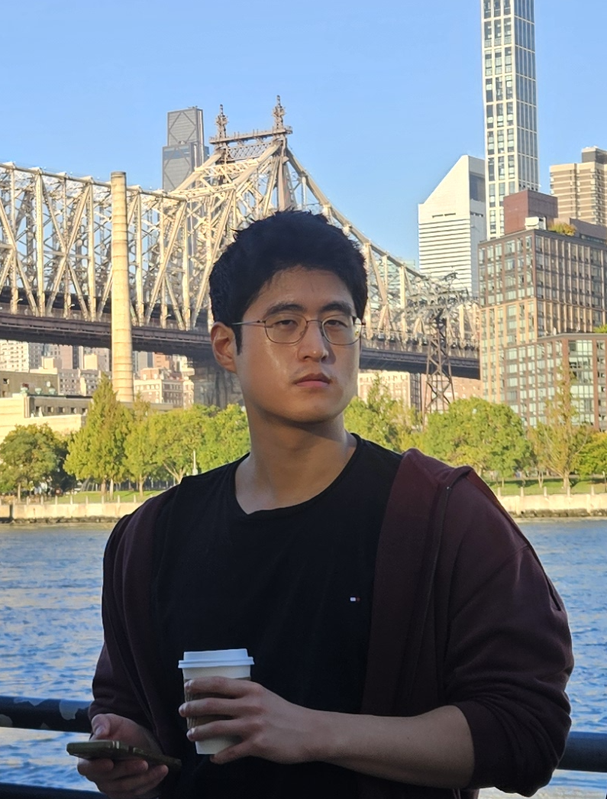

  
  

    <h1>Inwhan Chun</h1>
    

      I am a PhD student at Carnegie Mellon University, advised by <a href="https://www.cs.cmu.edu/~rpaccagn/">Riccardo Paccagnella</a>.
      I work at the intersection of computer architecture, systems, and security.
      Specifically, my research uncovers software vulnerabilities rooted in hardware and develops principled yet practical mitigations.
    

    

      Contact: <a href="mailto:inwhanc@andrew.cmu.edu">inwhanc@andrew.cmu.edu</a>
    

  

## Publications
\* denotes equal contribution

**Goldilocks and the Three P-States: Mitigating Hertzbleed with Formal Leakage Guarantees** 
Inwhan Chun\*, Christine Guo\*, Riccardo Paccagnella 
*IEEE Symposium on Security and Privacy (S&P)*, 2026. 
Distinguished Paper Award 
\[[paper](/assets/papers/goldilocks-sp2026.pdf)\]

**Scheduled Disclosure: Turning Power Into Timing Without Frequency Scaling** 
Inwhan Chun, Isabella Siu, Riccardo Paccagnella 
*IEEE Symposium on Security and Privacy (S&P)*, 2025. 
Pwnie Award – Most Underhyped Research 
\[[paper](/assets/papers/scheduled-disclosure-sp2025.pdf)\]
\[[code](https://github.com/cmu-msrg/scheduled-disclosure)\]

**SMT-Based Translation Validation for Machine Learning Compiler** 
Seongwon Bang, Seunghyeon Nam, Inwhan Chun, Ho Young Jhoo, Juneyoung Lee 
*Computer-Aided Verification (CAV)*, 2022. 
\[[paper](https://link.springer.com/chapter/10.1007/978-3-031-13188-2_19)\]

## Honors and Awards
**KFAS Overseas PhD Scholarship** (2023 – Present)  
<!-- &emsp;Full tuition and living expenses support for graduate studies. -->

**Kwanjeong Scholarship** (2019 – 2020)
